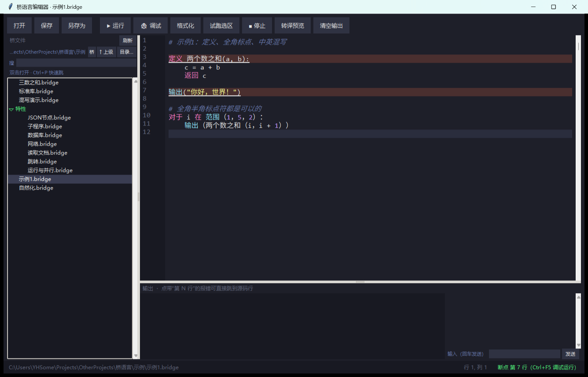

# 桥语言

> **桥语言是 Python 的「中文方言」（source-level dialect）。**
> 它不重新发明一门语言，而是在 Python 源码进入编译器之前加一层「方言转译」：
> 中文关键字、中文内建函数名、全角标点、中文引号 → 标准 Python 源码 → `compile()`。
> 因此**语义 100% 等于 Python，生态 100% 兼容**，学习成本只在词法层。

## 一、项目概述

> **先看结论**：能力清单、验证数据、明确边界都在 [交付说明.md](交付说明.md)（一页看完）。
> 只想跑起来：`python 桥.py init 我的项目` → `python 桥.py 运行 我的项目/主程序.bridge`。

### 1.1 项目背景

随着 AI 编程成为主流，大量代码由 AI 生成，而 AI 默认输出 Python。Python 是纯英文语言：`if`、`while`、`def`、`return`、`print`……

对中文用户（尤其是非专业开发人员）来说，这带来两层成本：

1. **阅读成本**：需要在大脑里把英文关键字翻译成中文语义；
2. **修改成本**：AI 生成代码后，想微调输出文本、循环次数、判断条件这类小改动，很多人只能重新开一轮对话，把整段代码再贴一遍——**为了改一个字，付一次 token**。

### 1.2 项目目标

桥语言的定位不是「替代 Python」，而是**给 Python 加一层方言皮肤**：

| 目标 | 说明 |
| --- | --- |
| 语法可读 | 关键字用中文：`如果 / 否则 / 对于 / 函数 / 返回` |
| 中英混写 | 中英文关键字可混用，不强制全中文 |
| 零语义偏差 | 转译后就是标准 Python，运行行为、性能、报错完全一致 |
| 双向可逆 | 方言源码 → 标准 Python 源码，可随时切回英文版 |
| 生态兼容 | `pip` 装的所有库照常 `导入`，不做任何魔改 |

### 1.3 为什么是「方言」而不是「新语言」

这是本项目的核心取舍，也是它和同类方案的分界线：

| 方案形态 | 代表 | 代价 |
| --- | --- | --- |
| 全新语言（自带运行时、不兼容 Python） | 易语言 | 拿不到 Python 生态，AI 生成的代码不能直接用 |
| fork CPython 改词法器（真·汉化版） | [草蟒](https://github.com/program-in-chinese/team_website/wiki/%E8%8D%89%E8%9F%92-Python-%E4%B8%AD%E6%96%87-API-%E4%B8%8E-IDE-%E6%94%AF%E6%8C%81%E5%B0%9D%E9%B2%9C)、[中蟒](http://chinesepython.org/doc/tut/tut/node2.html) | 要跟着 CPython 每个版本打补丁，工具链（IDE、调试器、类型检查器）全部半失效 |
| 只允许中文标识符 | PEP 3131（Python 原生支持 `变量 = 1`） | `if/while/def` 仍是英文，读起来还是夹生 |
| **源码级方言（本项目）** | 桥语言 | 只能靠转译层实现，无法让 IDE 原生高亮；换来的是零维护的语义兼容 |

一句话：**改的是「外观」，不动的是「内核」。**

### 1.4 项目意义与价值

- 对中文初学者：把「读代码」的门槛降到接近读中文说明；
- 对 AI 编程用户：AI 生成的 Python 里，`print("...")` 改成 `打印（“...”）` 就能看懂、就能改，不必再消耗一轮对话；
- 对 Python 生态：零侵入，不做第二个运行时。

## 二、需求分析

### 2.1 目标用户与场景

目标用户是编程爱好者与 AI 编程使用者，**不针对专业开发者**（专业开发者用英文 Python 效率更高）。

典型场景：

1. AI 生成一段脚本 → 用户把关键字换成中文，自己读懂逻辑；
2. 想改循环次数、输出文案、判断条件 → 直接改方言源码，不用回问 AI；
3. 学生入门教学 → 关键字先中文，再平滑过渡到英文 Python（方言和 Python 一一对应，可当作过渡桥）。

### 2.2 痛点与竞品分析

| 对比维度 | 易语言 | 草蟒（CPython 汉化 fork） | 纯 PEP 3131 中文变量 | 桥语言（方言层） |
| --- | --- | --- | --- | --- |
| 内核 | 自研，非 Python | 改造后的 CPython | 官方 CPython | 官方 CPython + 转译层 |
| 关键字是否中文 | 是 | 是 | 否（仍是 `if/for/def`） | 是（`如果/对于/函数`） |
| Python 库兼容 | 基本不兼容 | 兼容（但版本滞后） | 完全兼容 | 完全兼容 |
| 跟随 Python 新版本 | 无关 | 需持续打补丁 | 天然跟随 | 天然跟随（只依赖 `compile`） |
| 安装成本 | 独立 IDE/运行时 | 需装专用发行版 | `pip install python` | 一个 `pip` 包 |
| IDE 原生高亮 | 支持 | 支持（定制 IDE） | 支持 | 不支持（可提供语法插件） |
| AI 生成代码可直接复用 | 否 | 是 | 是 | 是 |
| 报错行号 | — | 原生 | 原生 | 靠转译层保持行号一致 |

结论：**桥语言放弃「IDE 原生支持」，换取「跟随任意 Python 版本 + 零安装负担 + 生态无痛」。**

### 2.3 核心需求

**功能需求**

| 编号 | 需求 | 说明 |
| --- | --- | --- |
| F1 | 中文关键字转译 | `如果/否则如果/否则/对于/当/函数/类/返回/导入/从/作为/尝试/捕获/最终/抛出/中断/继续/通过` 等 |
| F2 | 中文内建名映射 | `打印/长度/范围/字符串/整数/列表/字典/输入/求和` 等 → `print/len/range/str/int/list/dict/input/sum` |
| F3 | 中文异常名映射 | `名称错误/值错误/类型错误/除零错误` → `NameError/ValueError/TypeError/ZeroDivisionError` |
| F4 | 全角标点归一 | `（）：，；【】｛｝＝＋－＊／！＜＞` → 半角；全角空格 → 4 空格 |
| F5 | 中文引号字符串 | `“你好”` → `"你好"` |
| F6 | 中英混写 | 关键字可混用，中文标识符与英文标识符可混用 |
| F7 | 行号保持 | 报错行号必须等于方言源码行号 |
| F8 | 可反编译 | 转译结果可 `dump` 成标准 `.py` |

**非功能需求**

| 编号 | 需求 | 指标 |
| --- | --- | --- |
| N1 | 性能 | 转译是纯字符串扫描，千行文件 < 10ms，且解析结果可缓存 |
| N2 | 语义零偏差 | 不引入任何 Python 之外的行为 |
| N3 | 单文件可嵌 | 核心转译器不超过 200 行，无第三方依赖 |
| N4 | 错误可读 | 报错优先用原始行号，必要时提示「此处需加空格」 |

## 三、语言设计方案（方言层）

### 3.1 设计目标与原则

1. **只改词法，不改语法**：所有改动都发生在「字符 → token」这一步，Python 的语法树结构完全不变。
2. **一一对应、可逆**：每个中文关键字都唯一对应一个 Python 关键字，没有歧义扩展。
3. **行号稳定**：替换只做同行内的等量或非等量替换，绝不增删换行，保证 `traceback` 可直接对照方言源码。
4. **不碰字符串内容**：字符串字面量内的汉字（包括 `，`、`！（`）原样保留，因为你写的是数据，不是语法。

### 3.2 方言边界：什么改、什么不改

| 类别 | 是否方言化 | 原因 |
| --- | --- | --- |
| 关键字 `if/for/def/...` | ✅ 改 | 这是阅读门槛的主要来源 |
| 内建函数 `print/len/...` | ✅ 改 | 高频、好记，映射表稳定 |
| 异常类 `NameError/...` | ✅ 改 | 报错信息里也常见 |
| 全角标点、中文引号 | ✅ 改 | 中文输入法默认打出全角，不处理必报 SyntaxError |
| 缩进（4 空格） | ❌ 不改 | 缩进是 Python 的语法结构，方言不做「花括号化」——那会破坏语义 |
| 运算符 `+ - * / // % **` | ⚠️ 仅全角归一 | `＋` 会归一成 `+`，但**不**引入中文运算符（如 `加`），避免与算术优先级混淆 |
| `==` / `!=` | ✅ 增补 `等于` / `不等于` | 中文语境下 `等于` 比 `==` 更自然 |
| 标准库模块名 | ⚠️ 按表映射 | `模块` 表里登记过的才翻译（`数学`→`math`），没登记的原样保留 |
| 对象方法名 | ✅ 按表映射（新） | `数据.追加()`→`数据.append()`；新表 `方法`，**只在点号之后**生效 |
| 原生 Python 关键字 / 库名 | ✅ 原样透传 | `.bridge` 是 Python 的**超集**：`if`、`print`、`math.sqrt` 直接可用，与中文写法随意混写 |
| f-string 内部表达式 | ✅ 支持（v0.4） | 只翻 `{表达式}`，`{{ }}`、`:.2f`、`!r` 原样保留，见 `转译器/f字符串.py` |

### 3.3 词法规则与对照表

> **别名并存（多对一）**：一个 Python 名可以挂任意多个中文写法，全部生效。例如 `len` 认
> `长度 / 求长度 / 取长度`；`or` 认 `或者 / 或`；`if` 认 `如果 / 若 / 假如 / 倘若`。
> 英文原名永远可用。查某个词怎么映射：`python 桥.py 查 长度`。
>
> **行尾助词**：`当 计数 < 5 时:` / `如果 到了 的话:` —— 句尾的「时 / 的话 / 的时候」会被吃掉，产物与不写完全一致，见 [架构.md](架构.md) 5.10。
>
> **语句糖**：`重复执行（3）次:` → `for _ in range(3):`、`重复 k 次:`、`永久循环:` → `while True:`。
> 一行进一行出，行号与金标准 diff 都不受影响，见 [架构.md](架构.md) 5.11。
>
> **值位置特例**：`是` 在比较位置是 `is`（`等级 是 空`），在赋值等「值位置」是 `True`
> （`启动 = 是`）——同一个词按位置换读法，见 [架构.md](架构.md) 5.9。

**关键字（保留字）**

| 桥语言 | Python | 桥语言 | Python |
| --- | --- | --- | --- |
| 如果 / 若 | `if` | 定义 / 函数 | `def` |
| 否则如果 | `elif` | 返回 | `return` |
| 否则 / 不然 | `else` | 类 | `class` |
| 对于 | `for` | 导入 | `import` |
| 在 | `in` | 从 | `from` |
| 当 | `while` | 作为 | `as` |
| 并且 / 且 | `and` | 尝试 | `try` |
| 或者 / 或 | `or` | 捕获 | `except` |
| 不是 / 非 | `not` | 最终 | `finally` |
| 是 | `is` | 抛出 | `raise` |
| 真 / 假 / 空 | `True` / `False` / `None` | 中断 / 跳出 · 继续 / 下一步 | `break` · `continue` |
| 通过 | `pass` | 全局 / 非局部 | `global` / `nonlocal` |
| 带 | `with` | 产出 / 等待 / 异步 | `yield` / `await` / `async` |

**内建与常用类**

| 桥语言 | Python | 桥语言 | Python |
| --- | --- | --- | --- |
| 输出 / 打印 | `print` | 长度 / 求长度 | `len` |
| 范围 | `range` | 输入 | `input` |
| 字符串 / 整数 / 浮点 / 布尔 | `str` / `int` / `float` / `bool` | 列表 / 字典 / 集合 / 元组 | `list` / `dict` / `set` / `tuple` |
| 求和 / 求总和 | `sum` | 最大 / 求最大值 | `max` |
| 最小 / 求最小值 | `min` | 绝对值 / 求绝对值 | `abs` |
| 排序 / 求排序 | `sorted` | 枚举 / 映射 / 过滤 | `enumerate` / `map` / `filter` |
| 空值 | `None` | 真值 / 假值 | `True` / `False` |

**对象方法（只在点号后生效）**

| 桥语言 | Python | 桥语言 | Python |
| --- | --- | --- | --- |
| 数据.追加 / 数据.添加 | `append` | 数据.排序 | `sort` |
| 数据.内容 | `items` | 数据.键 / 数据.值 | `keys` / `values` |
| 数据.获取 | `get` | 数据.更新 | `update` |
| 句子.拆分 | `split` | 句子.替换 | `replace` |
| 句子.去除空白 | `strip` | 句子.大写 / 小写 | `upper` / `lower` |

> 注意 `排序` 的两副面孔：`排序(数据)` → `sorted(数据)`（内建），`数据.排序()` → `数据.sort()`（方法）。

**标准库模块（已中文化的成员）**

| 模块 | 成员举例 | 产物 |
| --- | --- | --- |
| `数学` → `math` | `数学.圆周率` / `数学.勾股斜边` / `数学.以二为底对数`（55 条） | `math.pi` / `math.hypot` / `math.log2` |
| `随机` → `random` | `随机.随机整数` / `随机.选择` / `随机.种子` | `random.randint` / `random.choice` / `random.seed` |
| `时间` → `time` | `时间.睡眠` / `时间.当前时间戳` / `时间.格式化时间` | `time.sleep` / `time.time` / `time.strftime` |
| `路径` → `os.path` | `路径.拼接` / `路径.存在` / `路径.拆扩展名` | `os.path.join` / `os.path.exists` / `os.path.splitext` |
| `系统` → `os` | `系统.创建目录` / `系统.列出目录` / `系统.环境` | `os.makedirs` / `os.listdir` / `os.environ` |
| `正则` → `re` | `正则.查找` / `正则.全部查找` / `正则.忽略大小写` | `re.search` / `re.findall` / `re.IGNORECASE` |
| `子进程` → `subprocess` | `子进程.运行` / `子进程.获取输出` / `子进程.管道` | `subprocess.run` / `check_output` / `PIPE` |
| `日期` → `datetime` | `日期.现在` / `日期.解析` / `日期.今天` | `datetime.now` / `strptime` / `today` |
| `时间差`（内建） | `时间差(3)` 就是 3 天（不用导入） | `datetime.timedelta(3)` |
| CSV | `表 = 读取("x.csv")` → `表.列("分数")` / `表.追加行([...])` / `表.保存()` | 二维表对象（pandas 那种感觉） |
| `迭代工具` → `itertools` | `排列` / `组合` / `笛卡尔积` / `累计` / `压平` | `permutations` / `combinations` / `product` / `accumulate` |
| `统计` → `statistics` | `平均` / `中位数` / `方差` / `标准差` | `mean` / `median` / `variance` / `stdev` |
| `集合工具` → `collections` | `计数器` / `默认字典` / `双端队列` | `Counter` / `defaultdict` / `deque` |
| `哈希` → `hashlib` | `新建摘要` / `二五六` / `十六进制摘要` | `hashlib.new` / `sha256` / `hexdigest` |
| `线程` → `threading` | `线程` / `当前线程` / `事件` / `锁` | `Thread` / `current_thread` / `Event` / `Lock` |
| `队列` → `queue` | `队列` / `后进先出队列` / `优先队列` | `Queue` / `LifoQueue` / `PriorityQueue` |
| `日志` → `logging` | `基础配置` / `记录信息` / `记录错误` | `basicConfig` / `info` / `error` |
| `数据库` → `sqlite3` | `连接` / `完整性错误`（高层用数据库对象） | `connect` / `IntegrityError` |
| `网络` → `urllib.request` | `获取` / `请求`（高层用 `取网页`/`发请求`） | `urlopen` / `Request` |
| `运行环境` → `sys` | `运行环境.参数` / `运行环境.标准输出.写` / `运行环境.退出` | `sys.argv` / `sys.stdout.write` / `sys.exit` |
| `json`（英文名） | `json.转字符串` / `json.解析` | `json.dumps` / `json.loads` |

> 模块名两种写法都认：中文别名（`数学.圆周率`）或真实模块名（`json.转字符串`、`os.path.拼接`）。
> 关键字参数名保持英文（`ensure_ascii=假`），免得和官方文档对不上。

**标点归一**

| 中文 | 半角 | 中文 | 半角 |
| --- | --- | --- | --- |
| `（）` | `()` | `【】` | `[]` |
| `，` | `,` | `：` | `:` |
| `；` | `;` | `＝` | `=` |
| `＋－＊／` | `+-*/` | `＜＞` | `<>` |
| `“…”` | `"…"` | `　`（全角空格） | 4 个半角空格 |

**歧义规则（关键设计）**

中文不加空格时，`如果名字:` 会被词法器读成**一个标识符**（`如果名字`）。桥语言的处理是双模式：

1. **严格模式（默认）**：关键字必须与其后的标识符之间有空格或标点，即 `如果 名字:`。全等匹配，绝不误伤变量名。
2. **前缀回退模式**：严格模式编译失败时，对连续汉字串做「最长关键字前缀切分」，`如果名字等于“桥”` → `if 名字 == "桥"`。
3. 回退模式仍失败才报错，并把报错行号映射回方言源码。

这样既保证「写对时零歧义」，又保证「手懒时能用」。

### 3.4 语法示例

```python
# 桥语言
导入 数学

函数 打招呼(名字):
    如果 名字:
        打印（“你好，” ＋ 名字）
    否则:
        打印（“你好，陌生人”）
    返回 真

对于 i 在 范围(3):
    打招呼（“爸爸” ＋ 字符串(i)）

尝试:
    打印（1 ／ 0）
捕获 除零错误:
    打印（“抓到了”）


# ---------- 等价的标准 Python ----------
import math

def 打招呼(名字):
    if 名字:
        print("你好，" + 名字)
    else:
        print("你好，陌生人")
    return True

for i in range(3):
    打招呼("爸爸" + str(i))

try:
    print(1 / 0)
except ZeroDivisionError:
    print("抓到了")
```

> 注意：`打招呼`、`名字` 这些标识符本来就合法——Python 3 从 PEP 3131 起原生支持 Unicode 标识符。
> 所以桥语言真正要解决的问题**只有三个**：关键字、内建名、全角标点/引号。

### 3.5 语义

- **求值策略、作用域、类型系统、GIL、内存管理：全部继承 CPython**，方言层不介入。
- **行号映射**：转译不做跨行改动，`traceback` 行号即方言源码行号；列号可能因中文宽度（字符 vs 显示宽度）而偏移，属已知偏差。
- **报错信息**：核心转译器只保证行号准确；异常消息的中文化由 `sys.excepthook` 做词表替换（后续版本）。

## 四、技术实现方案

### 4.1 整体架构

```
方言源码 .桥
     │
     ▼
① 字符扫描器（字符串感知）        ← 跳过注释 / 字符串 / 三引号
     │  关键字→Python、全角→半角、中文引号→英文引号
     ▼
② 标准 Python 源码（字符串）
     │
     ▼
③ compile(code, 文件名, 'exec')  ← 严格模式失败则回退前缀模式
     │
     ▼
④ exec / import 执行，traceback 行号 = 方言源码行号
```

为什么用「转译 + `compile`」而不是「`tokenize` 改 token」：实测 Python 3.13 的词法器会把 `打印（` 直接吞成一个 `NAME`（全角括号被当作标识符字符），token 级替换在这种情况下够不到。字符级扫描 + 字符串感知是唯一稳妥的路径。

### 4.2 核心实现（参考实现，已实测通过）

```python
# qiao.py —— 转译核心，纯标准库，无第三方依赖
import re

KEYWORDS = {
    '如果': 'if', '否则如果': 'elif', '否则': 'else', '当': 'while', '对于': 'for', '在': 'in',
    '不是': 'not', '并且': 'and', '或者': 'or', '是': 'is', '真': 'True', '假': 'False', '空': 'None',
    '函数': 'def', '返回': 'return', '类': 'class', '导入': 'import', '从': 'from', '作为': 'as',
    '尝试': 'try', '捕获': 'except', '最终': 'finally', '抛出': 'raise', '中断': 'break',
    '继续': 'continue', '全局': 'global', '非局部': 'nonlocal', '通过': 'pass', '带': 'with',
    '产出': 'yield', '异步': 'async', '等待': 'await', '等于': '==', '不等于': '!=',
}
BUILTINS = {
    '打印': 'print', '长度': 'len', '范围': 'range', '输入': 'input', '整数': 'int',
    '浮点': 'float', '字符串': 'str', '布尔': 'bool', '列表': 'list', '字典': 'dict',
    '集合': 'set', '元组': 'tuple', '绝对值': 'abs', '求和': 'sum', '最大': 'max', '最小': 'min',
    '排序': 'sorted', '枚举': 'enumerate', '映射': 'map', '过滤': 'filter',
}
EXCEPTIONS = {
    '异常': 'Exception', '名称错误': 'NameError', '值错误': 'ValueError', '类型错误': 'TypeError',
    '索引错误': 'IndexError', '键错误': 'KeyError', '属性错误': 'AttributeError',
    '除零错误': 'ZeroDivisionError', '文件未找到错误': 'FileNotFoundError',
}
MAP = {**KEYWORDS, **BUILTINS, **EXCEPTIONS}
KEYS_BY_LEN = sorted(MAP, key=len, reverse=True)
PUNCT = {'（': '(', '）': ')', '，': ',', '：': ':', '；': ';', '【': '[', '】': ']',
         '｛': '{', '｝': '}', '＝': '=', '＋': '+', '－': '-', '＊': '*', '／': '/',
         '！': '!', '＜': '<', '＞': '>', '％': '%', '＆': '&', '｜': '|', '　': '    '}
CJK = re.compile(r'[\u3400-\u9fff]+')


def split_run(run):
    """把连续汉字串切成 关键字/标识符 序列（前缀回退模式用）。"""
    parts, i = [], 0
    while i < len(run):
        hit = next((k for k in KEYS_BY_LEN if run.startswith(k, i)), None)
        if hit:
            parts.append(MAP[hit]); i += len(hit)
        else:
            j = i + 1
            while j < len(run) and not any(run.startswith(k, j) for k in KEYS_BY_LEN):
                j += 1
            parts.append(run[i:j]); i = j
    return parts


def translate(src, prefix_mode=False):
    """方言源码 -> 标准 Python 源码。行号严格不变。"""
    out, i, n = [], 0, len(src)
    while i < n:
        c = src[i]
        if c == '#':                                  # 注释原样透传
            j = src.find('\n', i); j = n if j < 0 else j
            out.append(src[i:j]); i = j; continue
        if c in '"\'':
            q = c * 3 if src[i:i + 3] == c * 3 else c  # 单/双/三引号，含转义
            j = i + len(q)
            while j < n:
                if src[j] == '\\':
                    j += 2; continue
                if src[j:j + len(q)] == q:
                    j += len(q); break
                if len(q) == 1 and src[j] == '\n':
                    break
                j += 1
            out.append(src[i:j]); i = j; continue
        if c == '“':                                  # 中文引号字符串
            j = src.find('”', i + 1); j = n if j < 0 else j
            body = src[i + 1:j].replace('"', '\\"')
            out.append('"' + body + '"'); i = j + 1; continue
        if c in PUNCT:                                # 全角标点归一
            out.append(PUNCT[c]); i += 1; continue
        if '\u3400' <= c <= '\u9fff':                 # 汉字：关键字 or 标识符
            m = CJK.match(src, i); run = m.group(0)
            if run in MAP:
                out.append(MAP[run]); i = m.end(); continue
            if prefix_mode:
                out.append(' '.join(x for x in split_run(run) if x)); i = m.end(); continue
            out.append(run); i = m.end(); continue
        out.append(c); i += 1
    return ''.join(out)


def compile_qiao(src, filename='<桥>'):
    """严格模式失败 -> 前缀回退模式 -> 仍失败则抛出。"""
    err = None
    for mode in (False, True):
        code = translate(src, prefix_mode=mode)
        try:
            return compile(code, filename, 'exec'), code
        except SyntaxError as e:
            err = e
    raise err


def run(src, filename='<桥>'):
    code, py = compile_qiao(src, filename)
    ns = {'__name__': '__main__'}
    exec(code, ns)
    return py, ns
```

### 4.3 让 `.桥` 文件能被 `导入`（import hook）

标准库 `importlib` 提供了现成入口：注册一个 `MetaPathFinder` 处理 `.桥` 后缀，读源码 → `translate` → `compile` → 执行建模块。核心三行逻辑：

```python
import importlib.abc, importlib.util, sys

class 桥加载器(importlib.abc.Loader):
    def __init__(self, path): self.path = path
    def create_module(self, spec): return None
    def exec_module(self, module):
        src = open(self.path, encoding='utf-8').read()
        code, _ = compile_qiao(src, self.path)
        exec(code, module.__dict__)

class 桥查找器(importlib.abc.MetaPathFinder):
    def find_spec(self, name, path, target=None):
        for d in (path or sys.path):
            p = f"{d}/{name.split('.')[-1]}.桥"
            import os
            if os.path.exists(p):
                return importlib.util.spec_from_loader(name, 桥加载器(p), origin=p)
        return None

sys.meta_path.insert(0, 桥查找器())
```

装好之后：`导入 我的工具` → 自动加载同目录 `我的工具.桥`。

### 4.4 语法糖引擎：让语言"自然化"的主力

词表只解决"词汇"，真正的语序自然化靠**整行重写**。一条糖 = (正则, 模板)，纯数据放
`规则/语法糖.py`，**加糖不动引擎**：

```python
语法糖 = [
    (r'^(?P<缩进>[ \t]*)重复执行\s*[（(]?(?P<次数>.+?)[)）]?\s*次\s*[:：]\s*$',
     '{缩进}for _ in range({次数}):'),
]
```

`{名字}` 自动换成正则的 `\g<名字>`，编译结果 `lru_cache` 缓存。执行顺序是
**糖 → 词替换 → 助词**：糖认中文锚点词，吐英文关键字；捕获组里的表达式（`求长度(数据)`）
随后被词替换继续翻译。

| 你写 | 产物 |
| --- | --- |
| `重复执行（3）次:` / `重复 3 次:` | `for _ in range(3):` |
| `永久循环:` / `死循环:` / `一直重复:` | `while True:` |
| `只要 条件 就重复:` | `while 条件:` |
| `重复执行直到 条件:` / `直到 条件 为止:` | `while not (条件):` |
| `等待 条件 直到:` | `while not (条件): pass` |
| `对于 每个 x 在 序列:` / `遍历 序列 中的 每个 x:` | `for x in 序列:` |
| `如果 条件 那么:` / `否则如果 条件 则:` | `if 条件:` / `elif 条件:` |
| `如果 条件 就 语句` | `if 条件: 语句`（单行） |
| `否则的话:` / `否则 语句` | `else:` / `else: 语句` |
| `定义函数 名(参数):` | `def 名(参数):` |
| `尝试执行:` / `捕获 值错误 时:` / `无论如何:` | `try:` / `except ValueError:` / `finally:` |
| `跳出循环` / `继续下一次循环` | `break` / `continue` |
| `设 X 为 Y` / `把 X 设为 Y` / `将 X 设为 Y` | `X = Y` |
| `将 X 增加 Y` / `将 X 减少 Y` | `X += Y` / `X -= Y` |
| `输出 值`（不加括号的裸写） | `print(值)` |

`设 X 为 Y`、`将 X 增加 Y`、`一直重复`、`重复执行直到`、`等待…直到`、`不成立` 这一组命名
照抄自 [Scratch](https://scratch.mit.edu/) 的中文积木块——那套词已经在中文编程启蒙里被几百万孩子用过，
借过来比自己造术语省一整轮学习成本。

配套的**关系词**（词表层）让条件句读起来像中文：

```python
如果 年龄 大于 18 并且 年龄 不大于 60:
    输出（年龄 乘以 2 减去 1）
```

产物：`if 年龄 > 18 and 年龄 <= 60:` / `print(年龄 * 2 - 1)`。

**四条安全线**：整行匹配、必须有锚点词、一行进一行出、缩进用 `{缩进}` 带回去（否则嵌套塌成顶层语句）。

### 4.5 报错中文化 + 编译缓存

**报错**（`转译器/报错.py` + `规则/报错.py`）：

```text
运行出错 · 除零错误：除数不能是 0
  第 4 行 │ 出问题()
  第 2 行 │ 打印（1 ／ 0）
  （英文原文：ZeroDivisionError: division by zero）
```

能翻的翻（异常名 27 条、消息句式 30 条），翻不了的保留英文；内部帧被过滤，行号指向 `.bridge`。

**反向查错**（`转译器/诊断.py`）：写错词时不再只说 `invalid syntax`，而是用编辑距离猜你想写什么——

```text
<诊断> 转译后仍然编译不过：invalid syntax
  第 1 行：如过 1:
可能的原因：
  · 第 1 行：「如过」是不是想写「如果」（= if）？
```

运行期同理：`name '求长肚' is not defined` → 「求长肚」是不是想写「求长度」（= len）？
只看报错行前后一行 / 报错的那个名字，只报距离够近的，最多 3 条——**宁可不说，也不瞎说**。

**缓存**（`转译器/缓存.py`）：`.bridgec` 存在源码旁 `__pycache__/桥缓存/`，键 =
路径 + 大小 + mtime + **规则指纹** + 版本。规则表一改，指纹变，旧缓存全部自动失效。
产物是"转译后的 Python 源码"，可读可跑，不是黑盒。命令：`python 桥.py 缓存 [清理]`。

### 4.6 轻量编辑器（tkinter，零第三方依赖）

`转译器/编辑器.py` 是一个能「点开就写、F5 就跑」的轻量 IDE。

**打开方式（任选）**：

| 方式 | 说明 |
|---|---|
| 双击 `桥编辑器.pyw` | ✅ 推荐：`.pyw` 关联到 `pythonw`，**不弹黑窗** |
| 把 `.bridge` 拖到 `桥编辑器.bat` 上 | bat 只做转发，内容纯 ASCII（见 [架构.md](架构.md) 5.13 的编码坑） |
| `python 转译器/编辑器.py 示例/混写演示.bridge` | 命令行，带文件打开 |



| 能力 | 说明 |
| --- | --- |
| 一键运行（F5） | 起子进程跑 `python 桥.py 运行 <文件>`，所以**在编辑器里跑 = 在终端里跑**，不存在 IDE 专用路径 |
| 未保存直接跑 | 内存里的内容落到 `.运行临时/` 再跑，不用先 Ctrl+S |
| 流式输出 | stdout / stderr 实时刷进下方输出区，长循环也能看；出错行标红 |
| 停止（Esc） | 直接 kill 子进程，死循环也能救 |
| 转译预览（Ctrl+E） | 就地看「你的 .bridge 会被转成什么 Python」，带行号 |
| **试跑选区（Ctrl+Enter）** | 选中一段只跑这一段（没选中就跑当前行），调一行不用整文件跑 |
| **断点（F9）** | 当前行打/取消断点，行底红条标记；打开别的文件会自动清空 |
| **调试（Ctrl+F5）** | 按断点跑：停在断点行、输出区下面有「调试命令」输入栏，敲 n/c/p 变量/l/q |
| **树内搜索** | 侧栏「搜」框实时过滤文件树（Esc 清空） |
| **报错行标红** | 运行出错后自动把「第 N 行」那一行标出来，不用低头找 |
| **保存时检查** | 保存后顺手编译一次：有语法错误标红提示，但**不阻止保存** |
| **交互式输入** | 输出区下方「输入（回车发送）」栏：程序 `输入("提示")` 会**先显示提示**再等你写，打完回车就送进去（回显一行「你输入：…」） |
| **输出可复制** | 输出区能鼠标选中、`Ctrl+C` 复制；右键有「复制 / 全选 / 粘贴并发送 / 清空」 |
| **自动保存** | 停手 1.2 秒自动存（保存时顺手检查语法，错只提示不拦） |
| **外部终端** | `Ctrl+Shift+F5`：开一个真终端窗口跑（需要 TTY 的程序用） |
| **断点按文件记忆** | 切到别的文件再切回来，断点还在 |
| **左侧文件树** | 递归列出所有子目录里的 .bridge（跳过 __pycache__/.tmp 等），双击即开、开完自动选中；刷新 重扫 |
| **快速打开（Ctrl+P）** | 输入几个字过滤文件名/路径（空格分隔多个关键词，全部命中才算），回车打开 |
| **收/放侧栏（Ctrl+B）** | 屏幕小的时候把文件树收起来 |
| **点报错跳行** | 输出里带「第 N 行」的报错（中文报错、traceback 都算），点一下直接跳到源码那一行并高亮 |
| **悬停看映射** | 鼠标停在中文词上，弹出 `输出 → print`、`设 → 句式糖 → {目标} = {值}`、`数据.追加 → append()` |
| 不弹黑窗 | 子进程用 `CREATE_NO_WINDOW`，输出全走管道，不会闪一下黑框 |
| 语法高亮 | 关键字/内建/模块/方法/字符串/注释/数字分色；**复用转译器自己的 `分段()`**，所以高亮和转译永远不会打架 |
| 其它 | 行号、当前行高亮、Ctrl+滚轮缩放字号、状态栏显示 行/列 + 退出码 |

为什么不用 VS Code 插件而写个小编辑器：`.bridge` 的语法是**动态的**（规则表随时加词），
插件要跟着改；而这个编辑器直接读 `规则/` 的合并结果，**加了新规则，高亮自动跟上，零维护**。

### 4.7 反向译：把 AI 写好的 Python 变成桥语言

转译是单向的（中文→英文），但**用户真正的入口是反方向**：AI 生成的 Python 铺天盖地，
得有一条"翻成桥语言"的通道。

```bash
python 工具/反向译.py <文件.py|目录> -o <输出>
```

- `tokenize` 切 token，只替换**能被正向规则还原**的词（关键字/内建/异常/模块成员/方法名）；
- 标识符、字符串、注释、第三方 API 一律不动；f-string 只翻 `{表达式}` 内部（和正向规则对着来）；
- 自带验收：产物再正向转译，与原文**逐字节比对**，不一致直接报行号。

想连**英文标识符**也改成中文（变量/参数/函数/类/常量/实例属性，跨文件一致）：

```bash
python 工具/反向译.py <项目>/程序 --译名 -o 输出
# 连模块文件名一起改（模块名 → 界面模块 / 数据库模块 …）
python 工具/译项目.py <项目> -o 输出
```

```python
# 改之前                       # 改之后
def team_home(h: Handler):     定义 队伍首页(h: 处理器):
    if not h.user:                 如果 不是 h.用户:
        return h.html(...)             返回 h.html(...)
```

`--译名` 的安全边界：模块名、三方 API 属性（`self.headers`）、框架钩子（`do_GET`）、
调用关键字参数（`timeout=30`）、内置名、双下划线名**一律不动**；翻出来会撞规则表的词也放过。
验收方式是"中文名换回英文后与原文逐字节比对"，OJ 项目 14 文件全部一致。

`金标准/03_循环.py` 转出来是这样：

```python
对于 i 在 范围(1, 6):
    合计 = 合计 + i
输出("1到5之和：", 合计)
```

**真实项目验证**：拿一个 14 文件 / 6406 行的 OJ 后端（stdlib + sqlite + http.server）整体转换，
12 个程序模块全部往返一致；转换后的 OJ **直接用桥语言源码启动并对外服务**：

```text
$ python 桥.py 运行 实验-oj转桥/oj.bridge --port 18080
   黄埔校区自己的 OJ  已启动
   考生端 : http://127.0.0.1:18080/      ← HTTP 200，登录页正常

$ curl -s -o /dev/null -w "%{http_code}" http://127.0.0.1:18080/
200
```

完整数据、前后对照、以及这轮实验在转译器上修出的 6 个真 bug，见
[实验-oj转桥/报告.md](实验-oj转桥/报告.md)。

### 4.8 交互式试写：`桥 repl`

不想建文件就先试一句：

```text
$ python 桥.py repl
桥语言 0.1 REPL —— 输入「帮助」看命令，「退出」离开
桥> 名字 = "爸爸"
桥> 输出（f"你好{名字}"）
你好爸爸
桥> 如果 名字 等于 "爸爸":
...>     输出（"对上了"）
对上了
桥> 查 如过
规则表里没有「如过」，是不是想写「如果」（= if）？
```

- 每行都走**完整转译管线**（语法糖、词表、f-string、报错中文化全部生效），
  所以 REPL 里试出来的行为 = 文件里跑出来的行为；
- "没写完"交给标准库 `codeop` 判定：它说 `None` 就继续 `...>`，说报错才是真报错；
- 表达式自动打印值（`1 + 1` → `2`），和官方 REPL 一致；
- 报错给中文 + 反向查错建议，命名空间保留，边改边试；
- 命令：`帮助` / `退出` / `清空` / `查看`（上次被翻成什么）/ `查 词`；也支持 `python 桥.py repl '输出（1）'` 一次性执行，
  以及管道：`echo '输出（1）' | python 桥.py repl`。

实现要点：不做"括号配平"的土办法，直接复用 Python 的 `codeop.CommandCompiler`
（`single` 模式），所以**多行块、缩进、表达式回显**的行为天然和官方 REPL 对齐。

### 4.10 三样 Python 没有的东西：跳转 / 运行并行 / 读取文档

这三样不是"翻译"，是**桥语言在 Python 之上加的语义**，所以由转译器改写 + 运行时支持：

**① 跳转（goto）**

```python
计数 = 0
标记 回头
输出（"第", 计数, "次")
计数 += 1
如果 计数 小于 3:
    跳转到 回头
```

`标记 X` 声明标签，`跳转到 X`（也可写 `跳转 X` / `goto X`）跳过去。实现方式是把这一段
改写成"状态机 + 派发循环"，跳转靠异常信号，所以**嵌套在 if/for 里也可靠**，变量全都还在。
跳到没声明过的标签会直接报「该标记不存在」。

**② 运行 / 并行：bridge 文件互相调用**

```python
运行("子程序.bridge")          # 等它跑完
甲 = 运行("./子程序.bridge")    # 拿它的 `返回` 值
并行("子程序.bridge")          # 开线程跑，不等、返回值丢掉
```

被调用的文件用 `返回 X`（模块级）交回结果——Python 不允许模块级 return，转译器把它
改写成 `raise 桥返回(X)`，由 `运行` 接住。

**③ 文件 / 文档：文件当对象用**

`文档` 是 `文件` 的**子类**；能改名是文件类的通用能力：

```python
文档 = 读取("./a.txt")          # 返回 文档（文件子类）
输出（文档.文件名, 文档.后缀, 文档.大小, 文档.存在）
输出（文档[0]）                # 第一个字符
输出（文档）                   # 当字符串用：内容
文档.改名("b.txt")             # 改名（写 `文档.文件名 = "b.txt"` 也一样）
文档.内容 = 文档.内容 + "你好"   # 改内容 = 回写磁盘
文档.追加("（追加）")           # 追加一行
副本 = 文档.复制到("./副本.txt")
副本.删除自己()                # `删除` 是关键字，桥语言里用「删除自己」或 `删除文件(路径)`
输出（是实例(文档, 文件)）      # True
```

**④ 读取和操作 JSON**

`.json` 后缀会让 `读取` 直接给你一个**能按字段操作**的对象：

```python
配置 = 读取("./config.json")
输出（配置.站点名）            # 属性写法
输出（配置["端口"]）           # 下标写法，两种都行
输出（配置.数据库.主机）        # 嵌套对象一层层点下去
配置.端口 = 9090
配置.管理员.追加（"王五")
配置.保存()                    # 写回：缩进 2、中文不转义
输出（配置.取("数据库.主机")）   # 点号路径取深层
输出（配置.有("端口")）
输出（配置.条目数）
输出（配置）                    # 打印就是格式化 JSON
```

- `新建文档("x.json", {...})` 能直接建一份 JSON；
- 读不存在的 `.json` 会报「要读取的文件不存在」，不会静默给空对象；
- 改完要 `保存()` 才落盘（避免写一半坏文件）。

示例：`示例/特性/JSON节点.bridge`（配 `配置.json`，跑完自动复原）。

**配套函数**

| 桥语言 | 作用 |
| --- | --- |
| `等待完成(句柄)` | 等某个 `并行` 跑完；不给参数就等全部 |
| `新建文档(路径, 内容)` | 建文件并返回 `文档` |
| `删除文件(路径)` | 删文件 |
| `并行("x.bridge")` | 返回线程句柄，可交给 `等待完成` |

> 特性说明见 `特性清单/`（1 跳转、2 运行并行、3 文档、4 JSON、5 表格、6 调试、7 自包含）。
> 示例：`示例/特性/跳转.bridge`、`示例/特性/运行与并行.bridge`、
> `示例/特性/读取文档.bridge`；JSON 对象见 `示例/特性/JSON节点.bridge`。

**几条边界（实测过的）**

- `标记` 只能写在**模块顶层**或**函数/类的第一层**；写在 `if`/`for`/`while` 里面会直接报
  「写在 if/for/while 里面了」——跳进一个块里没有意义，不如早报错；
- 跳转不能跨函数：从函数里 `跳转到` 外面的标签会报「没找到同一段代码里的标记」；
- 只有 `标记` 没有 `跳转到` 时，标签行会被抹成空行（行号不变），所以 REPL 里单喂一行标签也不会炸；
- `运行` 支持**嵌套**（被调文件里再 `运行` 同目录的另一个文件）；`等待完成()` 不带参数会等全部并行任务；
- `桥.py 编译` 出来的 `.py` **自带** `sys.path` 和运行时 import，可以脱离 `桥.py` 直接
  `python 输出.py` 跑（跳转/运行/读取文档都不缺名字）。

### 4.9 已知限制

| 限制 | 现象 | 处理 |
| --- | --- | --- |
| f-string 里的**嵌套双引号** | `f"{a["k"]}"` 在 3.11 及以下语法不合法，3.12+ 才行 | 按 Python 版本能力走，不额外兜底 |
| 列号偏移 | 中文关键字长度 ≠ 英文，`^` 指错位置 | 只保证行号，行内位置可能有偏差 |
| 前缀回退可能误切 | 变量名里恰好含关键字（如 `否则值`） | 默认严格模式不会触发；回退模式仅在严格模式编译失败时启用 |
| 金标准 03 未支持 | `当(条件)时重复执行:` 是手打版自创句式 | 已在自检里登记为**预期失败**（不计入退出码）；要支持就加一条语法糖 |
| REPL 不保留标签状态 | `标记/跳转到` 只在"一次提交的一整块"里成立 | 日常用编辑器跑文件；REPL 里单喂标签会被抹成空行 |
| 调试器只有行级断点 | 没有条件断点/监视面板，`n` 是逐行 | 需要时在源码里临时写 `如果 条件: 抛出` 之类观察 |

## 四·三、语言面补齐（运算符 / 数据库 / 网络 / 新语法）

| 新东西 | 写法 |
| --- | --- |
| 运算符 | `整除` `取模` `乘方` `按位与` `按位或` `按位异或` `左移` `右移` |
| 海象 | `如果 (乙 赋值为 10) 大于 5:` |
| 匿名函数 | `加一 = 匿名函数 x: x + 1` |
| 模式匹配 | `配对 甲:` / `情形 3:` |
| 复合赋值 | `将 甲 乘以 2` / `将 甲 乘方 2` / `将 甲 取模 3` |
| 数据库对象 | `库 = 读取("图书.db")`；`库.建表(...)`、`表.插入(...)`、`表.查询(...)` |
| 网络对象 | `响应 = 取网页("https://…")`；`.状态码` / `.文本` / `.JSON` / `保存()` |
| 命名检查 | `python 桥.py 检查 x.bridge --命名`（撞规则词会提醒） |
| 严格检查 | `python 桥.py 检查 x.bridge --严格`（被用但没定义的名字） |
| REPL 标签 | REPL 里 `标记/跳转到` 现在按"空行提交"整块执行 |

示例见 `示例/特性/数据库.bridge`、`示例/特性/网络.bridge`。

## 四·四、给 AI 的参考文档

| 文件 | 给谁用 | 内容 |
| --- | --- | --- |
| [AI参考.md](AI参考.md) | 人 / AI | 关键字、内建、异常、方法、模块成员、句式糖、独有语法、禁区、错误对照、完整例子 |
| [AI速查.txt](AI速查.txt) | 直接贴 prompt | 10 KB 紧凑版，一段话说明 + 全部映射 |
| [docs/桥语言规则.json](docs/桥语言规则.json) | 工具/插件 | 机器可读映射表 |
| [AGENTS.md](AGENTS.md) | 编码助手 | 入口文件：最小规则 + 常用命令 + 约定 |

打印速查：`python 桥.py AI`（`--完整` 看全量，`--json` 出机器可读，`--路径` 看位置）。

四份都由 `python 工具/导出AI参考.py` 从规则表生成——**规则一改，重跑一次就同步**（自检会盯着）。

## 四·五、便携包：解压到项目根就能用

```bash
python 工具/打包.py            # 生成 发布/桥-0.2.0.zip（约 0.41 MB）
```

把压缩包里的 `桥/` 解压到**任意项目根目录**，就完事了：

```text
你的项目/
├── 桥/                  ← 解压出来就这一坨
├── 你好.bridge          ← 你自己的代码，跟 桥/ 平级
```

```bash
python 桥/桥.py 运行 你好.bridge
```

**它跟"配 Python 环境"的区别**：

| 常规 Python 项目 | 桥语言便携包 |
| --- | --- |
| `pip install` / venv / requirements.txt | 不需要，包里自带全部代码 |
| 配 PATH / 环境变量 | 不需要，所有路径从 `桥.py` 自己推 |
| 装 exe / 改注册表 | 不需要，解压即用 |
| 依赖冲突 | 只要 Python ≥ 3.10，纯标准库 |
| 卸载 | 删掉 `桥/` 即可 |

包里有什么、三步上手、常见问题：见 [快速开始.md](快速开始.md)。
包内还带 `桥.bat`（双击用）、`bridge.py`（ASCII 入口，防止 cmd 代码页吃掉中文文件名）、
`校验.txt`（SHA-256 清单）。

> 打包脚本是白名单制：`实验-oj转桥/`、缓存、测试数据不进包；CI 里有
> `.github/workflows/便携包.yml`，打 tag 时自动打包 + 换目录验收 + 上传 artifacts。

## 五、验证

参考实现已落地成真实目录（见第八章与 [架构.md](架构.md)），不是纸面代码。实测环境 Python 3.13.7：

```text
$ python 自检.py
== 规则加载 ==     ok 规则表合并 / ok 词表就绪
== 示例 ==         ok 编译/运行 示例1.bridge / ok 示例1 输出断言
== 金标准 ==       ok 裸跑 01~10 全部 .py + ok 比对 01/02/04/05/10（手打版）
== 边界情况 ==     ok 声明消费 / ok 版本校验×2 / ok 前缀回退 / ok 字符串不动 /
                  ok 注释不动 / ok 行号稳定 / ok BOM 兼容 / ok 语法错误定位
== 别名与混写 ==   ok 别名表齐全 / ok 同义词不打架 / ok 同一目标多种写法等价 /
                  ok 方法表只在点号后生效 / ok 中英关键字混写 /
                  ok 原生 Python 可直接当 .bridge 跑
== 跨文件导入 ==   ok 导入 工具.bridge

通过 87 条，预期失败 0 条，失败 0 条（金标准 03 用了自创句式，见 金标准/说明.md；预期失败不算失败，退出码 0）
```

`金标准/` 的 10 份 `.py` 是「正确答案」，同名 `.bridge` 现在**十份都在**（6 份手打 + 4 份参考版），
自检会**自动**比对运行输出。另外这 10 份 `.py` 与「反向译成桥语言再转回来」的产物**逐字节一致**（10/10），
证明这些题在现有规则下都做得出来。

```text
$ python 桥.py 运行 示例/示例1.bridge
你好，世界！
3
7
```

金标准（`金标准/` 下 10 份 `.py` + 手打的同名 `.bridge`）逐份比对转译产物与运行输出，
**10/10 往返一致**：把 `.py` 反向译成桥语言再正向转译回来，产物与原文逐字节相同。

验证要点：

1. 关键字全量替换，中文标识符（`两个数之和`、`成绩表`）原样保留；
2. 全角标点 `（），：＝＋＜【】` 全部归一，`SyntaxError` 消失；
3. `捕获 除零错误` 正确捕获 `ZeroDivisionError`；
4. 无空格写法 `如果名字等于“桥”` 通过前缀回退编译成功；`非`/`或`/`且`/`跳出`/`下一步` 等别名与英文原名同时可用；
5. 行号一致：异常报错直接指向 `.bridge` 源码对应行；
6. 字符串与注释内的汉字**不受**任何规则影响；
7. 可选的 `桥语言版本("0.1")` 声明被消费成注释，不进 Python 产物；`转译器位置` 已废弃；
8. Windows 带 BOM 的 `.bridge` 文件能正常读写。

## 六、路线图

| 阶段 | 内容 | 状态 |
| --- | --- | --- |
| v0.1 | 转译核心：关键字 + 内建 + 全角标点 + 中文引号 + 双模式 | 已完成 |
| v0.2 | `桥.py` 命令行（运行/查看/编译/检查/规则）、`.bridge` 导入钩子、规则加载器、架构文档、自检脚本 | 已完成 |
| v0.3 | 报错中文化、`.bridgec` 编译缓存、语法糖引擎（整行重写） | 已完成 |
| v0.4 | f-string 字段翻译 ✅、反向查错提示（「这里应该是 `如果`，你写了 `若`」）、`桥 repl` | 进行中 |
| v1.0 | 编辑器语法高亮插件、pip 包发布 | 规划 |

## 七、定位再确认

- 桥语言**不追求**完全去英文化：库名、方法名、第三方 API 保持英文（`list.append`、`json.dumps`），因为翻译它们会破坏生态。
- 桥语言**不追求**成为专业开发语言：专业开发直接写英文 Python 更省事。
- 桥语言的目标只有一个：**让中文读者在最短时间内看懂 AI 写出来的代码，并能自己动手改。**

## 八、代码结构与快速开始

**从零开始，三行：**

```bash
python 桥.py init 我的第一项目        # 生成能跑的起步工程（主程序 + 工具 + README）
python 桥.py 运行 我的第一项目/主程序.bridge
python 桥.py repl                    # 想试一句就试一句
```

生成的 `主程序.bridge` 开箱即跑，不用改一个字：

```python
导入 工具

定义 打招呼(名字: 字符串) -> 字符串:
    返回 f"你好，{名字}"

对于 名字 在 【"爸爸"， "同学"】:
    输出（打招呼(名字))

如果 分数 至少 90 那么:
    输出（"等级：", "优秀"）
否则的话:
    输出（"等级：", "及格"）
```

已有的 `python` 项目想"加几个 .bridge 文件"？不用 init——直接把文件放进项目，
用 `python <桥语言目录>/桥.py 运行 xxx.bridge` 跑就行；`.bridge` 和 `.py` 可以互相 `导入`。

```
桥语言/
├── 桥.py            命令行：运行 / 查看 / 编译 / 检查 / 规则 / 查 / 缓存 / repl / init
├── 桥编辑器.pyw      双击打开轻量编辑器（推荐，无黑窗）
├── 桥编辑器.bat      同样的入口，可把 .bridge 拖上去
├── 自检.py           87 项自检，改完代码必跑
├── 架构.md           数据流、目录职责、规则契约、扩展指南、踩坑记录
├── 交付说明.md        能力清单 + 验证数据 + 明确边界（一页看完）
├── docs/             截图
├── 转译器/
│   ├── 主转译器.py    管线本体（声明 → 分段 → 归一 → 成员 → 方法 → 语法糖 → 词替换 → 助词 → 编译）
│   ├── 脚手架.py      桥 init：生成起步工程（主程序 + 工具 + README）
│   ├── 编辑器.py      轻量 IDE（tkinter：高亮 / F5 运行 / 停止 / 转译预览）
│   ├── REPL.py        交互式试写（桥 repl：codeop 判"没写完"，表达式自动回显）
│   ├── 跳转.py        `标记`/`跳转到` → 状态机派发循环（goto）
│   ├── 运行时.py      运行/并行/文件/文档/JSON/表格 + 信号类
│   ├── 调试.py        断点调试（sys.settrace，只跟踪用户帧）
│   ├── 自包含.py      把运行时内联进编译产物（--自包含）
│   ├── 报错.py        中文报错（异常名 + 句式 + 行号 + 英文原文）
│   ├── 诊断.py        反向查错（编辑距离：你是不是想写 X）
│   ├── 体检.py        规则表体检（重叠/非法映射/漏占位）
│   ├── 缓存.py        .bridgec 编译缓存（规则指纹自动失效）
│   ├── 规则加载.py    扫描 规则/ 目录、合并表、冲突检查、缓存
│   ├── 导入钩子.py    让 .bridge 能被 `导入`
│   └── 规则/         ★ 所有翻译知识只放这里 ★
│       ├── 关键字.py   如果/若/假如/对于/定义/返回 + 关系词（大于/至少/乘以…）共 91 条
│       ├── 标准库.py   输出/求长度/区间/值错误 …（内建 58 条、异常 21 条）
│       ├── 方法.py     对象方法：追加/内容/键/值/排序（48 条，点号后生效）
│       ├── 语法糖.py   ★ 整行重写：重复执行N次 / 对于每个 / 如果…那么 / 设…为 / 一直重复（33 条）
│       ├── 报错.py     报错中文化（异常名 27 条 + 消息句式 30 条）
│       ├── 标点.py     全角 → 半角（26 条）
│       ├── 数学.py     数学 → math（55 个成员：三角/双曲/对数/数论/浮点）
│       ├── 时间.py     时间 → time（13 个成员）
│       ├── 路径.py     路径 → os.path / 系统 → os（29 个成员）
│       ├── 运行环境.py 运行环境 → sys（21 个成员）
│       ├── JSON.py     json.转字符串 / json.解析（4 个成员）
│       └── 随机.py     随机 → random（10 个成员）
├── 图书管理系统/       ★ 真实小项目：菜单 + JSON 存储 + 借阅上限/逾期罚金
├── 教程/               10 章入门 + 可直接跑的示例（教程/示例/）
├── vscode-桥语言/      VS Code 扩展：高亮 + 运行（工具/导出语法.py 生成语法）
├── pyproject.toml      pip 打包（装完能用 `bridge` / `桥` 命令）
├── 命令.py             控制台入口（console_scripts 的壳）
├── .github/workflows/  CI：三系统 × 三 Python 跑自检/体检/回归
├── 示例/
│   ├── 示例1.bridge    定义 + 全角标点 + 中英混写（同目录有 1:1 对照 .py）
│   ├── 混写演示.bridge  英文/中文关键字、别名、原生库混在同一个文件里
│   ├── 自然化.bridge   句式糖 + 关系词 + 助词，读起来接近中文
│   ├── 标准库.bridge   时间 / 路径 / 系统 / json 的中文化用法
│   ├── 三数之和.bridge ★ OI 实战：排序 + 双指针，O(n²)，自带对拍样例
│   └── 特性/          跳转 / 运行与并行 / 读取文档 三个可跑示例
├── 工具/
│   ├── 反向译.py       ★ Python → 桥语言（带往返验证），AI 生成代码的入口
│   ├── 改名.py / 译名.py  英文标识符 → 中文（词根表 + 安全边界）
│   ├── 译项目.py       ★ 整项目翻译：模块文件名 + 导入 + 变量名一起改
│   ├── 基准.py         转译/编译/缓存耗时基准
│   ├── 截图.py         截一张编辑器窗口图（PrintWindow，不依赖前台）
│   └── 回归.py         全量回归（CLI 十命令 + 示例 + OJ 冒烟）
├── 实验-oj转桥/       ★ 真实项目实验：14 文件 / 6406 行 OJ 后端转成桥语言 ★
│   ├── 报告.md        数据、运行证据、修出的 6 个 bug、局限
│   └── 程序/          11 个模块（__init__.bridge + 子模块）
└── 金标准/           ★ 手打对练用的金标准 ★
    ├── 说明.md        手打规则 + 中英对照表 + 每份的考点
    ├── 01_基础输出.py  … 10_综合.py（10 份标准 Python）
    └── （01/02/04/05/10 手打版 · 06–09 参考版 · 03 待修，自检自动比对）
```

```bash
python 桥.py 运行  示例/示例1.bridge
python 桥.py 查看  金标准/01_基础输出.bridge       # 看转译后的标准 Python
python 桥.py 编译  金标准/01_基础输出.bridge -o x.py # 落盘成 .py，与 01_基础输出.py diff
python 桥.py 检查  示例/示例1.bridge                # 只转译不执行
python 桥.py 规则                                  # 列出现有规则表
python 桥.py 体检                                  # 规则表体检（重叠/非法映射/漏占位）
python 桥.py 查 长度                               # 查一个词的映射与同义写法
python 桥.py repl                                 # 交互式试写（不建文件）
python 桥.py init 我的第一项目                        # 生成能跑的起步工程
python 转译器/编辑器.py                            # 打开编辑器（或双击 桥编辑器.pyw）
python 自检.py                                     # 87 项（含金标准比对）
python 工具/基准.py                                 # 转译/缓存耗时基准
```

新增一条规则 = 往 `转译器/规则/` 丢一个文件，不用改代码（`时间` / `路径` / `JSON` 就是这么加的）：

```python
# 转译器/规则/网络.py
模块 = {'网络': 'urllib.request'}

成员 = {'网络': {'打开网址': 'urlopen'}}
```

```python
# 用法
导入 网络
内容 = 网络.打开网址("https://example.com")
输出（读取后解码(内容)）
```

详细约定见 [架构.md](架构.md) 第三章「规则模块契约」与第四章「扩展指南」。

## 九、许可证

MIT License —— 与 Python 生态保持一致的宽松许可。
